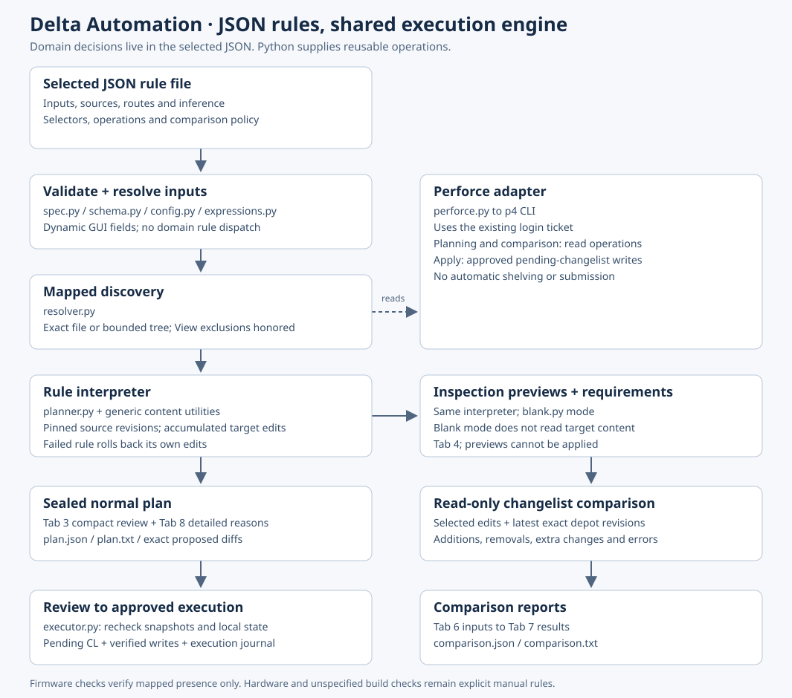

# Architecture

[Mermaid source](architecture.mmd) · [JSON authoring contract](rules.md) · [Worksheet coverage](../CHECKLIST_COVERAGE.md)

The selected JSON owns file paths, selectors, domain constants, inference and comparison policy. `spec.py` validates that document; `catalog.py` only retains compatibility imports. No rule ID, chipset name or pack name selects hidden Python behavior.

| Layer | Files | Responsibility |
| --- | --- | --- |
| Entry and inputs | `main.py`, `cli.py`, `gui.py`, `config.py` | Load selected pack; build dynamic fields; validate saved inputs. GUI workers report through an event queue. |
| Specification | `spec.py`, `schema.py`, `expressions.py` | Validate schema 2 and references/cycles; evaluate explicit expressions without executing code. |
| Discovery | `resolver.py`, `perforce.py` | Bind declared sources to Views/depot roots; enforce mapping coverage; distinguish unmapped from queried-but-absent. |
| Content utilities | `operations.py`, `reference.py`, `transforms.py`, `json_ops.py` | Select and edit Make, init, XML, JSON and text; retain unrelated content; surface ambiguity. |
| Planning | `planner.py` | Read revision snapshots, execute ordered steps, accumulate per-file edits and requirements; roll back a failed rule. Seal the resulting plan. |
| Blank preview | `blank.py` + same planner | Produce inspection content without reading target contents. It cannot be applied. Normal plans also record source previews. |
| Comparison | `comparison.py`, `comparison_report.py` | Attribute selected CL edits; check latest exact paths for uncovered additions/removals; produce reasons and evidence. |
| Execution | `executor.py` | Validate approved digest, connection, Views, snapshots and local state; write exact bytes to a pending CL and journal progress. |

The normal plan contains exact before/after bytes, revisions, source/input metadata, reasons and diffs. Pack changes invalidate cached previews and GUI approval. The executor applies the reviewed plan's bytes; it does not reinterpret current JSON rules during application.

Rules may share a target file. Later operations see earlier proposed content; the final edit is compared against the original snapshot. A failed rule restores its previous edits/requirements. Unresolved checks remain visible while independent rules may still complete.

Changelist comparison is read-only and preserves exact depot path identity. A selected addition can match a preview directly; otherwise latest depot content can satisfy it. Declared removals check absence using the same removal operation. An unreadable file produces an error. Rules choose file-wide init presence and XML/JSON requirement semantics explicitly.

Firmware existence checks inspect mapped file records only. Hashes elsewhere protect reviewed plan content and compare copied binary files; they do not establish firmware compatibility. Device/build checks remain explicit manual rules.
